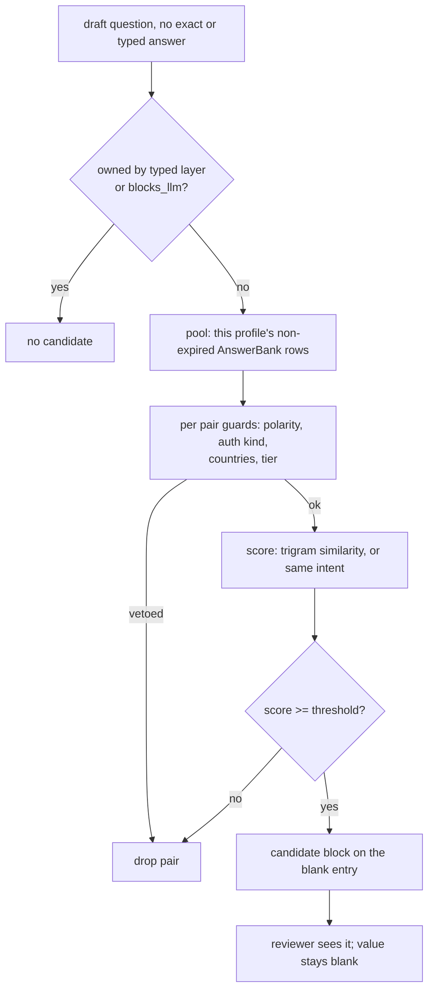

# Candidate answers for reworded questions (Phase 4b)

## Summary

When a draft question has no exact saved answer but is worded differently from a question the user has already answered, show that earlier answer to the reviewer as a **candidate**. A candidate is never a value: the field stays blank and held for review, and it is never counted as submitted or learned evidence. Matching is deterministic and runs in Python over the user's own answered questions: character-trigram similarity plus a small set of intent rules, behind hard guards for opposite meanings, tiers, countries and typed facts. A labelled set of reworded and near-miss pairs gates the thresholds, and a measure-only report (a command and a section of the learning report) shows how often a shown candidate matched what the user typed or changed it to. Embeddings are deliberately deferred (see Scope Boundaries).

## Problem Frame

Exact matching (`normalize_question_key`) strips decoration only, so every new wording of the same question is a new question. First real use (issue #130) found the remaining retyping is reworded questions: 4 wordings of gender, 4 of race/ethnicity, 5 of sponsorship, 3-4 of "how did you hear". The consolidated requirements already say embedding or similar retrieval "proposes candidates only" (FR5.4, FR8.3) and that nothing fuzzy may be submitted unconfirmed (NFR2, a hard zero). See origin: `docs/plans/2026-10-03-2300-consolidated-requirements.md` (FR5.4, FR8.3, FR8.6, NFR2, Open Questions 6 and 7).

**Relation to the origin's Phase 4b row.** The consolidated requirements list embeddings retrieval (FR8.3, FR8.10) and the weekly shadow gate under Phase 4b, and Open Question 6 says the embedding/worker-image work is Phase 4b. This plan changes that on purpose: it ships the reworded-question component (#130) with trigram similarity and intent rules first, and defers embeddings until the labelled set shows what they would add. The origin doc is updated in this PR to say so (Documentation Plan).

The tension to design around: text similarity scores "authorized to work" and "NOT authorized to work" as near-identical, and two questions can differ only by a country. A confidently wrong candidate shown next to a legal question is the failure to prevent, not a missed match.

## Requirements

- R1. A draft question with no exact or typed answer gets up to 3 candidates drawn only from that user's own answered questions (AnswerBank rows, non-expired). Never another profile's rows.
- R2. A candidate never sets `value`, never clears `needs_review`, never sets `needs_confirmation` to false, and never changes `unanswerable_required`. A field with a candidate is blank exactly as it was without one. (NFR2)
- R3. Guards reject a pair rather than score it: polarity or negation difference, work-authorization vs sponsorship kind, differing named countries, differing risk tier (unless the two share an intent, in which case the riskier tier governs, because the classifier knows fewer wordings than the intent table), a number or capitalised name that appears in one question and nowhere in the other, two different intents, and any question the typed layer owns (typed facts, `blocks_llm`). A country named in only one of the two questions also vetoes. Fail closed: when either question is T0/T1, or its tier is unknown (the classifier's default for an unrecognised question), a pair matches only when their non-decoration word sets are equal or differ by an allowlisted wording change; anything else is no candidate. A location-sensitive question is a candidate only from a row saved for the job's region or marked "applies everywhere".
- R4. Intent rules recognise the common questions (notice period, start date, relocation, how did you hear, years of a skill, gender, race/ethnicity, veteran, disability, sponsorship, authorization) and let two differently worded questions of the same intent match even when their text similarity is low. Intent only widens candidate lookup; it never keys or fills an answer.
- R5. A candidate's stored value is shown only in a form the live field can accept (mapped onto the field's options, or free text for a text field). If it cannot be mapped the candidate is shown as text only, with no "use this" action.
- R6. Using a candidate goes through a per-field accept action (U3) and the existing remember flow: the user may tick "Always use this answer" and the new wording then matches exactly next time. A value taken from a candidate is recorded as candidate-accepted, is **not** treated as user-authored, and is excluded from the consensus learner's evidence and from precision reporting. A user who types or changes the value afterwards makes it their own answer as usual.
- R7. A labelled set of reworded pairs and near-miss pairs, seeded from the #130 clusters, is checked in. At the configured threshold the matcher must reach at least 80% recall on reworded pairs (the target; revisit after the first run) and produce **zero** matches on near-miss pairs, as a test. The checked-in near-miss set proves only the classes it names, so thresholds are tuned on one half and verified on a separate held-out half, and a comment says so. Real observed question pairs from drafts, with answers removed, are added to the held-out half when available.
- R8. What was shown, and whether the submitted value came from the one-click accept or from the user typing or changing it, is recorded per observation. A command and a section of the learning report state how often a shown candidate equalled the submitted value, per tier, counting only answers the user typed or changed, and report accept rate separately. Measure only: nothing reads it to change behaviour.
- R9. The matcher is a dependency-free leaf (pure functions, no DB or network), like `apps/accounts/tiering.py` and `apps/accounts/question_semantics.py`. A setting turns candidates off.
- R10. Candidates are shown for every tier with one-click accept (decided with the user; reference-only text for legal and commercial questions was offered and declined). The protections for that choice are R2, the fail-closed rule in R3, R6 and the held-out check in R7.

Origin acceptance for #130: a labelled set with recall on intended pairs and zero false merges on near-misses; a fuzzy match never produces an unconfirmed T0/T1 submission. Both are R7 and R2.

---

## Scope Boundaries

- No auto-fill from a fuzzy or intent match in any tier. Keying answers by intent (proposal step 1 in #130) is held back until the measure in R8 shows it is safe.
- No new answer storage format and no change to `normalize_question_key`.
- No change to the typed-fact resolver or the tier classifier. The consensus learner changes in one place only: its eligibility filter skips observations marked candidate-accepted (U4).

### Deferred to Follow-Up Work

- **Embedding retrieval** (MiniLM, pgvector `QuestionEmbedding`, worker-image-only torch, pinned weights). Only if the labelled set shows trigram plus rules leaves meaningful recall on the table. The candidate interface in U2 is written so a second source can add candidates later. (issue #130; FR8.3, FR8.10)
- **Filling from an intent match**, the **enable/disable gate** (precision lower bound 99%, n at least 30, 2 consecutive weeks, auto-disable) and a **scheduled weekly precision task**: Phase 5. This PR provides the command and report section; Phase 5 adds the schedule when the gate needs it.
- Showing "similar to ..." on the Answers page questions panel (U3 only covers the draft review).
- Separate issues, not in this PR: #129 (LLM path gates by category, not tier), #131 (stale panel cache), #132 (structured address).

---

## Context & Research

### Relevant Code and Patterns

- `apps/accounts/services/answer_resolver.py`: `normalize_question_key`, `resolve_answer` (typed fact, then AnswerBank, then legacy), `load_bank_rows`, `write_answer`. Candidates are a new step *after* all of these return nothing; they never change `resolve_answer`'s result.
- `apps/accounts/question_semantics.py`: pure leaf with `authorization_kind`, country mention extraction, negation regexes, `is_location_sensitive`, `blocks_llm`. The guards (R3) reuse these rather than re-deriving them.
- `apps/accounts/tiering.py`: `classify_tier`, `classify`. Tier comparison in guards uses these.
- `apps/auto_apply/services/answer_resolution.py` (`resolve_field_answers`) and `apps/auto_apply/services/drafting.py` (builds `answers_payload` entries with `needs_review`, `provenance`, `learned_value`): where a blank entry can carry extra metadata without changing its value.
- `apps/auto_apply/services/answer_memory.py` (`remember_reviewed_answers`, `record_observations`): the remember flow (R6) and where an observation is written (R8).
- `apps/accounts/models.py` `AnswerObservation` (append-only; new nullable fields need a migration, latest is `0015_github_enrichment`).
- `apps/accounts/services/shadow_metrics.py` (`shadow_stats`, `wilson_lower_bound`) and `apps/accounts/management/commands/learning_report.py`: the pattern for measure-only reporting.
- `config/settings/base.py`: settings are `env.int(...)` constants near the schedule (for example `LEARNING_MIN_DISTINCT_EMPLOYERS`).
- `templates/web/_auto_apply_queue_list.html`: the draft review rows and the existing `needs_confirmation` presentation.
- Test conventions (AGENTS.md): plain `django.test.TestCase`; pure leaves use `SimpleTestCase`; JSON fixtures under each app's `tests/fixtures/`. `apps/accounts/tests/test_import_rule_coverage.py` is the pattern for a coverage guard over rule IDs.

### Institutional Learnings

- `docs/solutions/` has no entry on question matching. The nearest rule is the one in `question_semantics.py` and AGENTS.md: a confidently wrong answer is worse than none; verbs are deliberately not stripped from keys because a false merge is worse than a miss.
- #130 comment (first real use): regex/typed settings stay the first layer; a semantic or fuzzy match sits behind them for questions nothing else answers; reuse the held-for-confirmation flow and shadow metrics; self-reinforcement must be avoided.

### External References

None. The method (character n-gram similarity, Jaccard over trigram sets) is standard and implemented here directly; no new dependency.

---

## Key Technical Decisions

- **Trigram similarity is computed in Python over the user's own rows, not with Postgres `pg_trgm`.** A profile has tens to hundreds of answered questions, so scoring them in memory is cheap, deterministic and testable as a pure leaf, and it needs no extension, no migration and no DB-specific behaviour in CI. `pg_trgm` stays an option if pools ever grow large.
- **Intent rules widen the candidate pool and never fill.** The decision in #130 to "key the answer by intent" is deferred behind the R8 measure, so no tier gets a silent fill from a fuzzy source.
- **Guards run before scoring and veto.** A pair rejected by a guard is never ranked, whatever its similarity. Order of cheapest-to-riskiest: typed-fact ownership, polarity, authorization kind, countries, tier.
- **Polarity is checked by token set, not by trusting similarity.** Negation and requirement words ("not", "no", "without", "never", "do not", "n't") are extracted from each question; a mismatch in the set rejects the pair. This is deliberately over-strict: a rejected true pair is a miss, a merged opposite is a defect.
- **Candidates for every tier, with one-click accept and fail-closed guards.** Decided with the user over the safer reference-only option. The extra protection: T0/T1 and unknown-tier questions use the strict word-set rule in R3, the source and earlier question are named, and accepted values never feed the learner or the precision number.
- **The candidate lives next to the entry, not in it.** The draft entry gains an optional `candidate` block (earlier question text, stored value, mapped value if any, score, source tier, intent). `value`, `needs_review`, `needs_confirmation`, `provenance` are untouched, so every existing submit gate and test keeps its meaning.
- **Hook point is `drafting.py`, after `_carry_forward_confirmed_answers`.** Candidates are computed only for entries still blank with no answer-bank or typed provenance, so a field that carry-forward filled never keeps a stale candidate. The call passes the entry's options and field type (needed to map the value) and the job's region. This avoids changing the LLM-facing `ResolvedAnswer` contract in `apps/auto_apply/llm/base.py`. The exact hook position is confirmed when implementing.
- **Observation fields avoid a second plaintext copy of legal answers.** `AnswerObservation` gains nullable `candidate_question_key`, `candidate_equal` (the submitted value equalled the candidate under `_fold`) and `candidate_accepted` (the value came from the one-click accept). The raw candidate value is not stored on the observation: it is already in the AnswerBank row it came from. No foreign key, consistent with the model's append-only posture.
- **Accepting is its own POST, not a form prefill.** A per-field accept action posts only the field identifier; the server re-derives the candidate from the draft owner's own pool, maps it through the same cleaning as a typed edit (`edit_auto_apply_draft`), writes it into the draft entry with `candidate_accepted` set, and keeps the draft ownership check. No candidate id, key or value is read from the request. The review field input is empty by default; nothing is prefilled.
- **Thresholds are settings, tuned on the labelled set.** `QUESTION_CANDIDATE_MIN_SCORE`, `QUESTION_CANDIDATE_MAX` and an on/off flag, as `env`-backed constants near the other domain settings.

---

## Open Questions

### Resolved During Planning

- Pool of questions to match against: AnswerBank rows (any source, non-expired), keyed question text from `question_text`. Not `AnswerObservation`, which holds drafts' submitted values and would double-count.
- Should an imported or learned row be a candidate source: yes, with its source shown, locked and user rows ranking first. Rows whose value was originally stored through a candidate accept are excluded from the pool for **measurement** so accepted answers cannot raise their own measured precision; they still appear to the user.
- Evaluation location: the `learning_report` command gains a candidate section and the shared metrics live in `shadow_metrics.py`. No scheduled task and no dashboard in this phase.

### Deferred to Implementation

- Final similarity threshold and the intent rule list: set from the labelled set, not guessed here.
- Whether a multi-select or checkbox-group field can show a mapped candidate or only text: decided when mapping is written (R5); text-only is the safe fallback.
- Exact placement of the `candidate` block in the review template.

---

## High-Level Technical Design

*This illustrates the intended approach and is directional guidance for review, not implementation specification. The implementing agent should treat it as context, not code to reproduce.*

| Question pair | Guard result |
|---|---|
| "Will you now or in the future require sponsorship?" / "Do you require visa sponsorship?" | pass, same kind and polarity |
| "Are you authorized to work in the US?" / "Are you NOT authorized to work in the US?" | veto, polarity differs |
| "Are you authorized to work in the US?" / "Will you require sponsorship?" | veto, authorization kind differs |
| "Do you have a US passport?" / "Do you have a UK passport?" | veto, countries differ |
| "What is your notice period?" / "Notice period?" | pass |

---

## Implementation Units

### U1. Question matcher leaf: trigrams, guards and intents

**Goal:** A pure module that, given two question texts, says whether one is a plausible candidate for the other and how strongly, and names a question's intent when it recognises one.

**Requirements:** R3, R4, R9.

**Dependencies:** none.

**Files:**
- Create: `apps/accounts/question_matching.py`
- Create: `apps/accounts/tests/test_question_matching.py`
- Create: `apps/accounts/tests/fixtures/question_pairs.json` (shared with U3 and U5). U1 seeds it with the reworded and near-miss pairs from the #130 clusters and the T0/T1 question shapes U3's invariant test needs; U5 expands and splits it.

**Approach:**
- Normalise for comparison only (lowercase, punctuation collapsed, decoration like "(optional)" and a leading "please" removed). This is separate from `normalize_question_key` and never changes keys.
- Trigram set per text with word padding; score is Jaccard over the two sets.
- The fail-closed rule from R3 is a guard too (`strict_tier`): for T0/T1 or unknown-tier pairs it compares word sets after removing decoration and a small allowlist, so qualifier and antonym differences ("terminated" vs "laid off", "felony" vs "misdemeanor", "at least 18" vs "at least 21") are vetoed without each being enumerated.
- Guards as small named functions returning a reason string or nothing, so a rejection can be explained in tests and the report: `typed_owned`, `polarity`, `auth_kind`, `countries`, `tier`. They call `question_semantics` and `tiering`, not new regexes, wherever those already decide the same thing.
- Intent rules as an ordered table of (intent name, patterns), first match wins. Compound or ambiguous text returns no intent. Rules cover the list in R4 only.
- Public surface: a function returning a `Match(score, via, intent, vetoed_reason)` for a pair, and one returning the intent of a single text. Imports only `question_semantics` and `tiering`, keeping the leaf boundary.

**Patterns to follow:** `apps/accounts/question_semantics.py` (leaf docstring, dataclasses, fail-closed posture); rule IDs and a coverage guard like `apps/accounts/tests/test_import_rule_coverage.py`.

**Test scenarios:**
- Happy path: "Notice period?" matches "What is your notice period?" above threshold; "Will you require visa sponsorship either now or in the future?" matches "Do you require immigration sponsorship?".
- Happy path (intent): two gender wordings with low trigram overlap match via the gender intent.
- Edge case: empty and whitespace text, a very long text, non-ASCII and emoji text return no match and do not raise.
- Edge case: "(optional)", trailing `*`, a leading "please" and case do not change the score.
- Error path (strict tier): pairs differing by one qualifier word or number ("ever been terminated" / "ever been laid off", "at least 18" / "at least 21", "currently employed by" / "previously employed by") are vetoed; an unrecognised question text is treated as unknown tier and held to the same rule.
- Error path (guards): "authorized to work" vs "NOT authorized to work" vetoed as polarity; authorization vs sponsorship vetoed; "US passport" vs "UK passport" vetoed as countries; a T1 vs a T2 question vetoed as tier; a question for which `blocks_llm` is true vetoed as typed-owned.
- Edge case: a guard veto wins even when the score is 1.0 and when the intents are equal.
- Integration: every pair in `question_pairs.json` is evaluated; the recall and zero-false-merge assertions live in U5 but this unit's tests exercise the file loads and each guard has at least one near-miss pair.

**Verification:** Every guard has a failing near-miss test; the module imports nothing from `apps.auto_apply`, `apps.web` or models.

**Built (2026-10-15):** `apps/accounts/question_matching.py` with 39 tests. The first run against the fixture exposed gaps the plan did not foresee, fixed in the module: the typed-fact layer's `authorization_kind` calls any text containing "immigration" ambiguous (so "immigration sponsorship" is paired using a local variant that strips that word); `country_mentions` reads "of Python" as an unresolved place (its unresolved flag is ignored, and a named-term rule covers the real case); the tier classifier files some rewordings under a different tier (shared intent now takes the riskier one); and one swapped name or skill merged two questions on trigram score alone (new numbers, named-term and different-intent vetoes). The fixture's held-out half was consulted while fixing these, so it is no longer a clean held-out set for those classes; U5 adds fresh pairs.

---

### U2. Candidate retrieval service

**Goal:** Given a profile and a question, return up to N candidates from that profile's own answered questions, mapped to the live field when possible.

**Requirements:** R1, R2, R5, R9.

**Dependencies:** U1.

**Files:**
- Create: `apps/accounts/services/question_candidates.py`
- Create: `apps/accounts/tests/test_question_candidates.py`
- Modify: `config/settings/base.py` (settings for threshold, max, on/off)

**Approach:**
- Pool is the profile's non-expired `AnswerBank` rows (reuse `load_bank_rows` data when the caller already has it, to avoid a per-question query). Rows with an empty `question_text` or a `legacy:` key are skipped.
- Skips the exact key (that case is `resolve_answer`'s, not a candidate) and skips when learning or candidates are disabled by setting.
- Takes the asking profile and the job's region. Discards any row whose `profile_id` is not the asking profile, even when the caller passed `bank_rows`. A row for a location-sensitive question (`question_semantics.is_location_sensitive`) is kept only if its `scope_region` equals the job's region or its `source_detail` has `applies_everywhere`. Question text is truncated to a fixed length before scoring.
- Ranking: user-locked, then user, then learned, then imported, then score; ties by most recently updated. Returns plain dataclasses: earlier question text, stored value, value mapped onto the live options when `_map_to_options` rules allow (otherwise `None`), score, how it matched, source, tier.
- Never writes anything, never imports `apps.auto_apply`.
- Result is a list of candidates; a future second source (embeddings) would add candidates through the same return type.

**Patterns to follow:** `answer_resolver.load_bank_rows`, `_map_to_options`; keep the module free of view/task imports like the other services.

**Test scenarios:**
- Happy path: a profile with "What is your notice period?" answered returns it for "Notice period?", with mapped value when options fit and `None` when they do not.
- Edge case: no rows, one row, rows from another profile (never returned), an expired row (skipped), a `legacy:` row (skipped), an empty `question_text` row (skipped).
- Edge case: the exact normalized key is not returned as a candidate.
- Edge case: more matches than the maximum returns exactly the maximum, ordered by source then score.
- Error path: guards from U1 veto a pair that would otherwise score high (the polarity and country pairs), end to end through the service.
- Integration: a question owned by typed facts (work authorization with a typed fact present) returns no candidates; with no typed fact present and the guard `auth_kind` unequal, still no cross-kind candidate.
- Isolation: with two profiles holding the same wording, only the asking profile's row is returned; a `bank_rows` dict mixing two profiles' rows still returns only the asking profile's.
- Region: a relocation answer saved for a US job is not a candidate on an India job; the same row marked applies-everywhere is.

**Verification:** A test asserts no query beyond the pool load when `bank_rows` is supplied; no test or code path mutates AnswerBank.

**Built (2026-10-16):** `apps/accounts/services/question_candidates.py` (`find_candidates`) with 21 tests, plus the three `QUESTION_CANDIDATE*` settings in `config/settings/base.py` (feature off by default). It imports a few private helpers from `answer_resolver` (`_is_expired`, `_map_to_options`, `_employer_name`) to stay consistent with the resolver instead of copying them.

---

### U3. Attach candidates to draft entries and show them in review

**Goal:** A blank, held draft entry carries its candidate, the reviewer sees it, and a per-field accept action fills it as a candidate-accepted value that still flows through the remember flow.

**Requirements:** R1, R2, R5, R6.

**Dependencies:** U2, and the fixture seeded in U1.

**Files:**
- Modify: `apps/auto_apply/services/drafting.py` (attach an optional `candidate` block to blank or `needs_review` entries with no answer provenance)
- Modify: `apps/auto_apply/services/answer_resolution.py` only if the hook needs the resolver's `bank_rows` to be passed through
- Modify: `templates/web/_auto_apply_queue_list.html` (render the candidate and a "use this answer" action)
- Modify: `apps/web/views.py` and its URL configuration: a per-field accept action beside `edit_auto_apply_draft`, with the same draft ownership check. It marks the entry `candidate_accepted` and does not set `user_edited`.
- Test: `apps/auto_apply/tests/test_drafting_service.py`, `apps/auto_apply/tests/test_answer_resolution.py`, `apps/web/tests/` for the review rendering and save

**Approach:**
- Candidate block sits beside `value`, never in it, and is computed on a copy so the attach step cannot change `value`, `needs_review`, `needs_confirmation` or `provenance`. Any exception in the matcher is caught, logged without question text or values, and yields no candidate.
- "Use this answer" is a per-field POST (see Key Technical Decisions). Accepting sets `candidate_accepted` on the entry; `record_observations` copies the flag to the observation. If the user then types or changes the value, it is no longer candidate-accepted and counts as their own answer.
- The candidate block is dropped from the draft payload on submit, is never written to logs or put in an LLM prompt, and the submit path never reads it.
- Not shown on a field whose entry already has a value, or typed or answer-bank provenance.
- Template text states it is a suggestion from an earlier question and names that question, not that it is correct. For T0/T1 the text says it still needs the user's own confirmation.
- No JS framework needed; this is server-rendered like the rest of the review page.

**Patterns to follow:** how `needs_confirmation` and `learned_value` are carried on entries (`drafting.py`), and the "Confirm N remembered answers" form in `_auto_apply_queue_list.html`.

**Execution note:** Write the R2 invariant test first (a property check over a corpus of T0/T1 questions that `value`, `needs_review` and `needs_confirmation` are identical with and without candidates) and keep it green throughout.

**Test scenarios:**
- Happy path: a reworded question gets an entry with blank `value`, `needs_review` true and a `candidate`; the review page renders the earlier question and value.
- Covers R2. Invariant: for every T0/T1 question in the labelled corpus, the entry's `value`, `needs_review`, `needs_confirmation`, `provenance` and the draft's `unanswerable_required` are identical with candidates on and off.
- Covers R6. Accepting the candidate and saving with "Always use this answer" ticked writes an AnswerBank row for the new wording, and the next draft matches it exactly.
- Edge case: a candidate whose value cannot be mapped onto the live options renders as text with no action; a file field and a long-text narrative question get no candidate.
- Edge case: candidates setting off, or no pool, leaves the entry byte-identical to today's.
- Error path: a matcher that raises leaves the draft identical to the candidates-off result.
- Covers R2. A draft whose only answer is a candidate, with no accept action, stays blank and held; the rendered input is empty by default.
- Covers R6. Accepting a candidate marks `candidate_accepted` and does not set `user_edited`; editing the accepted value afterwards makes it user-authored.
- Error path (tamper): a POST naming a candidate id, key or value, or a draft owned by another user, is ignored or 404s; the value is re-derived from the owner's pool and re-validated against the live options.
- Edge case: a field filled by carry-forward never keeps a candidate block.
- Integration: submit gate unchanged: a draft with an unaccepted candidate still cannot be sent while the field is blank and required.
- Authorization: another user cannot see or post a candidate belonging to a draft that is not theirs (existing 404 behaviour preserved).

**Verification:** Existing drafting, review and submit-gate tests pass unmodified; the new invariant test passes.

**Built (2026-10-16), with these deviations from the text above:**
- Candidates are a `candidates` list (up to 3) on the entry, not a single `candidate` block.
- The accept is not a separate endpoint: the review form's "Use this answer" button posts the whole form to the existing `edit_auto_apply_draft` with `accept__<i>=<question_key>`, so other unsaved edits are kept and the same ownership check and field validation apply. The key only selects among candidates the server re-derives from the owner's own answers; anything else is ignored. A hidden first "Save answers" button keeps Enter from triggering an accept.
- A legal or commercial (T0/T1) question's accepted value is **held**: `needs_confirmation` with provenance origin `answer_candidate`, so the existing per-field confirm tick and send gate apply, and the bulk "confirm remembered answers" button does not cover it. This keeps NFR2 (no unconfirmed embedding-sourced T0/T1) intact while the fill itself is still one click. A factual (T2) accept is simply filled.
- Candidates are dropped from `draft.answers` when the draft is sent, and are not in the submit snapshot.

---

### U4. Record candidates on observations and report precision

**Goal:** Know, per tier, how often a shown candidate equalled what the user typed or changed it to, and how often it was simply accepted. Behaviour changes in one place only: accepted candidates are not learner evidence.

**Requirements:** R8.

**Dependencies:** U3.

**Files:**
- Modify: `apps/accounts/models.py` (add `candidate_question_key`, `candidate_equal` and `candidate_accepted` to `AnswerObservation`, nullable or defaulted)
- Create: `apps/accounts/migrations/0016_answerobservation_candidate_fields.py`
- Modify: `apps/auto_apply/services/answer_memory.py` (`record_observations` stores the candidate that was shown)
- Modify: `apps/accounts/services/learning.py` (`_eligible_observations` skips observations with `candidate_accepted`)
- Modify: `apps/accounts/services/shadow_metrics.py` (candidate precision per tier over non-accepted observations, accept rate, Wilson lower bound)
- Modify: `apps/accounts/management/commands/learning_report.py` (new section; counts only, no question text or values)
- Test: `apps/accounts/tests/test_learning_models.py`, `apps/accounts/tests/test_learning.py`, a new `apps/accounts/tests/test_candidate_metrics.py`

**Approach:**
- All three new fields are nullable or default false, so the migration is additive and safe on live rows.
- `candidate_equal` is computed when the observation is written, under the same folding the learner uses (`_fold`). Precision counts only observations where a candidate was shown and `candidate_accepted` is false (the user typed or changed the value), so a click-through cannot raise the number. Accept rate is reported separately.
- Candidates drawn from rows that were themselves stored through an accept are excluded from the precision denominator.
- Report output is counts and bounds per tier only. There is no scheduled task in this phase.

**Patterns to follow:** `shadow_stats` and `wilson_lower_bound`; the `learning_report` command.

**Test scenarios:**
- Happy path: an observation made from a draft whose entry carried a candidate stores the candidate key, `candidate_equal` and `candidate_accepted`; a draft without one stores nulls and false.
- Happy path: precision over three typed-or-changed observations (two equal, one different) is 2/3 with the expected Wilson bound; accepted observations are excluded from it and counted in the accept rate.
- Covers R6. The consensus learner does not count a `candidate_accepted` observation toward consensus.
- Edge case: zero observations gives a zero bound without a division error; multi-value (list) answers compare folded and order-insensitive.
- Edge case: observations are append-only: attempting to update still raises.
- Integration: running the command over a seeded profile prints the counts and no question text or answer values.
- Migration: applies on a database holding existing observations and `makemigrations --check` is clean.

**Verification:** Existing learner and shadow tests pass unchanged apart from the one added filter case; the report command has no side effects.

**Built (2026-10-16):** migration `0016_answerobservation_candidate_fields`; `record_observations` stores `candidate_question_key`, `candidate_equal`, `candidate_accepted`; the learner skips `candidate_accepted` observations (already excluded in practice because an accept does not set `user_edited`; the explicit exclusion is a belt-and-braces guard); `shadow_metrics.candidate_stats` and a section in `learning_report`. A row saved with "Always use this answer" after an accept carries `source_detail.via_candidate`, which excludes candidates drawn from it from the precision denominator.

---

### U5. Labelled pairs, evaluation command and rule coverage

**Goal:** Make "recall on reworded pairs, zero false merges on near-misses" a checked-in, repeatable test and a command that shows the trade-off at each threshold.

**Requirements:** R7, and the origin acceptance for #130.

**Dependencies:** U1, U2. The feature setting defaults to off until this unit's test passes on the tuned threshold; this unit then switches it on.

**Files:**
- Modify: `apps/accounts/tests/fixtures/question_pairs.json` (created in U1; expanded here)
- Create: `apps/accounts/management/commands/question_match_eval.py`
- Create: `apps/accounts/tests/test_question_match_eval.py`
- Create: `apps/accounts/tests/test_question_match_rule_coverage.py`
- Create: `docs/plans/2026-10-06-002-question-matching-rules.md` (rule IDs for the guards and intent names, cited by tests)

**Approach:**
- Fixture is split into a tuning half and a held-out half, each holding two lists: `reworded` (same fact, different wording) and `near_miss` (look alike, different or opposite meaning), each pair with a short label. Seeded from the #130 clusters (gender, race/ethnicity, sponsorship, "how did you hear", veteran/disability per employer) plus authored near-misses: negated vs plain authorization, authorization vs sponsorship, US vs UK passport, relocate vs on-site, salary current vs expected.
- Authored near-misses include the qualifier cases from U1 (terminated vs laid off, felony vs misdemeanor, at least 18 vs 21, current vs previous employer) and compound legal text for intent bucketing.
- The test asserts at least 80% recall on `reworded` and exactly zero matches on `near_miss`, at the configured threshold, on both halves; thresholds are chosen on the tuning half only. A comment states what the fixture does and does not prove. A failing near-miss blocks the change; a failing reworded pair only lowers recall.
- The command prints recall and false-merge counts across a sweep of thresholds, and lists unmatched reworded pairs and any false merge by label, so thresholds are chosen from data. No database access.
- The coverage guard fails if any rule ID in the rules doc has no citing test, mirroring the import rules.

**Patterns to follow:** `apps/accounts/management/commands/import_eval.py` and `apps/accounts/tests/test_import_eval.py`; `apps/accounts/tests/test_import_rule_coverage.py`.

**Test scenarios:**
- Happy path: the command exits zero and prints a table when run on the checked-in fixture.
- Covers the #130 acceptance. Every near-miss pair yields no match; recall on reworded pairs is at or above target.
- Error path: a fixture pair that is malformed (missing label) fails loudly; adding a near-miss that the matcher would accept makes the suite fail.
- Edge case: an empty fixture list reports "no pairs" and exits non-zero rather than passing vacuously.
- Integration: the coverage guard fails when a rule ID is added to the doc without a citing test.

**Verification:** The suite fails if a guard is removed (checked by deleting one locally during development), and the command output is reproducible.

---

## System-Wide Impact

- **Interaction graph:** `drafting.py` gains a read-only step after carry-forward; `apps/web/views.py` gains one accept action; `record_observations` writes three new fields on a model nobody else updates; the consensus learner's eligibility filter gains one exclusion. `resolve_answer`, `write_answer`, the typed-fact resolver and the submit gate are untouched.
- **Error propagation:** a failure while computing candidates must not fail drafting. The step is wrapped so any exception logs and yields no candidate, and the draft proceeds exactly as today.
- **State lifecycle:** no new persisted state except three observation fields. Account deletion already removes `AnswerObservation` through the profile cascade (NFR8), so nothing extra is needed.
- **API surface parity:** the review page is the only surface in this phase; the Answers page panel is deferred.
- **Integration coverage:** the property test in U3 (values identical with and without candidates) is the cross-layer proof that mocks alone would not give.
- **Data handling:** the candidate block holds earlier legal and EEO answers in the draft payload. It is excluded from logs and LLM prompts, dropped at submit, and the observation stores a flag and the equality result, not a second copy of the value.
- **Unchanged invariants:** T0/T1 answers still need explicit confirmation; learned answers are still held in every tier; typed facts still win; the LLM path is untouched.

---

## Risks & Dependencies

| Risk | Mitigation |
|---|---|
| A candidate for an opposite-meaning question is shown next to a legal field | Guards veto before scoring; the labelled near-miss set must pass with zero matches; R2 means even a shown candidate cannot be submitted |
| One-click accept for every tier invites accepting without reading, and a wrong accepted answer saved with "Always use this answer" becomes an exact-match fill later | Decided with the user. Mitigations: strict word-set rule for T0/T1 and unknown tiers, source and earlier question named, accepted values are not learner evidence and not in the precision number, `QUESTION_CANDIDATES_ENABLED` switches the feature off. Revisit reference-only for legal and commercial tiers if the accept-without-edit rate on those tiers is high |
| Zero false merges on the fixture is read as zero in production | The fixture proves only its named classes; a held-out half and real observed pairs are added; the strict word-set rule covers qualifiers nobody enumerated |
| Candidates push users to accept without reading | Wording says it is from an earlier question and names it; for T0/T1 states confirmation is still required; precision reporting (R8) shows if acceptance and correctness diverge |
| Over-strict guards lower recall | Accepted by design (a miss costs a retype, a false merge costs trust); recall is reported by the evaluation command so tuning is data-driven |
| Matcher cost grows with large pools or very long text | Pool is one profile's rows (tens to hundreds); scoring is in memory; question text is truncated to a fixed length before scoring; `pg_trgm` remains an option |
| Staleness: an earlier answer is outdated | Expired rows are skipped; the source and the earlier question are shown so the reviewer can judge |
| Intent rules age as ATS wording changes | Rules are plain data in one table with rule IDs and a coverage guard; the evaluation command shows new misses |

Dependencies: issue #129 is not required for this work because candidates do not touch the LLM path; it still must land before the optional LLM path is enabled in production.

---

## Documentation Plan

- Add the rules doc `docs/plans/2026-10-06-002-question-matching-rules.md` (U5).
- Update the Phase 4b row and Open Question 6 in `docs/plans/2026-10-03-2300-consolidated-requirements.md` to say trigram plus rules shipped first and embeddings are deferred.
- Update epic #117 and issue #130 status when the PR is open.

## Operational / Rollout Notes

- Additive migration `accounts.0016`; no new service, image or dependency. Restart `web worker beat` after deploy.
- `QUESTION_CANDIDATES_ENABLED` defaults to off until U5 validates the threshold, then on; it can be turned off without a deploy; off restores today's behaviour exactly.
- Stacking: this branch is based on `feat/github-import-enrichment`; retarget as parents merge.

## Sources & References

- Origin: `docs/plans/2026-10-03-2300-consolidated-requirements.md` (FR5.4, FR8.3, FR8.6, FR8.10, NFR2, Open Questions 6 and 7)
- Issue #130 (reworded questions) and its first-real-use findings comment; epic #117
- Related code: `apps/accounts/services/answer_resolver.py`, `apps/accounts/question_semantics.py`, `apps/accounts/tiering.py`, `apps/auto_apply/services/drafting.py`, `apps/auto_apply/services/answer_memory.py`, `apps/accounts/services/shadow_metrics.py`
